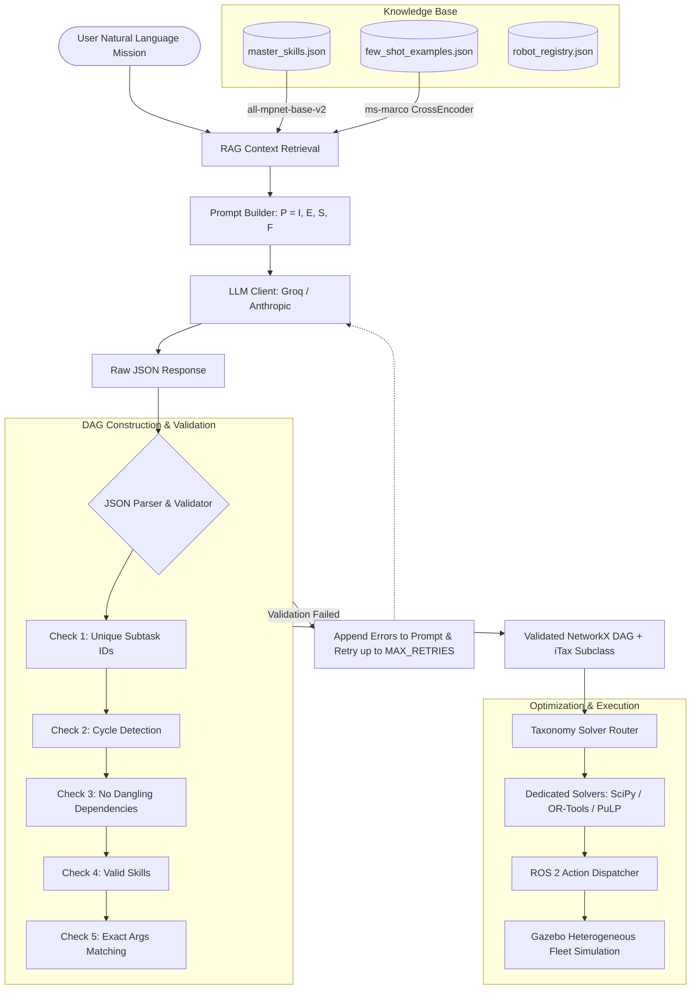

# AGENT.md — Developer & AI Agent Onboarding Guide

Welcome to the **TEMPO Mission Planner** repository (`kaavish-mission-planner`). This document provides a comprehensive orientation for any AI agent or human contributor working on this codebase.

---

## 1. Project Overview & Identity

* **Project Title:** TEMPO: Taxonomy-Enforced Multi-Robot Planning and Optimization via Large Language Models
* **Academic Context:** Kaavish (Final Year Project), Fall 2026 – Spring 2027, Habib University, Computer Science.
* **Core Problem:** Large Language Models (LLMs) excel at natural-language understanding and task decomposition, but perform poorly at numerical and combinatorial optimization. When LLMs attempt to schedule and allocate multi-robot tasks directly, they produce infeasible, unbalanced, or suboptimal schedules ("not quite my tempo").
* **TEMPO's Core Thesis:** 
  Use the LLM **strictly** for what it is good at:
  1. Translating natural language missions into structured, atomic subtasks.
  2. Identifying dependencies between subtasks.
  3. Classifying the mission into an **iTax taxonomy subclass**.
  
  Once classified, the task allocation and scheduling are handed off to **dedicated mathematical solvers** (e.g., Hungarian algorithm, Integer Linear Programming, Metaheuristics) matched specifically to that problem subclass.

---

## 2. Foundational Literature & Academic Resources

All key literature is located directly in [`resources/`](file:///home/taha/Desktop/fyp/kaavish-mission-planner/resources):

1. **[`resources/TEMPO.pdf`](file:///home/taha/Desktop/fyp/kaavish-mission-planner/resources/TEMPO.pdf): Project Proposal**
   * Detailed breakdown of the project scope, CS contributions, 7 target subclasses, Semester 1 & 2 deliverables, tech stack, and evaluation metrics.
   * *Required reading before making architectural changes.*

2. **[`resources/Gerkey and Matarić - 2004 - A Formal Analysis and Taxonomy of Task Allocation in Multi-Robot Systems.pdf`](file:///home/taha/Desktop/fyp/kaavish-mission-planner/resources/Gerkey%20and%20Matari%C4%87%20-%202004%20-%20A%20Formal%20Analysis%20and%20Taxonomy%20of%20Task%20Allocation%20in%20Multi-Robot%20Systems.pdf)**
   * Formalized MRTA across 3 axes:
     * **Robot Type:** Single-Task (**ST**) vs. Multi-Task (**MT**). *(Note: TEMPO targets only ST robots).*
     * **Task Type:** Single-Robot (**SR**) vs. Multi-Robot (**MR**).
     * **Allocation Horizon:** Instantaneous Assignment (**IA**) vs. Time-Extended Assignment (**TA**).

3. **[`resources/Korsah et al. - 2013 - A comprehensive taxonomy for multi-robot task allocation.pdf`](file:///home/taha/Desktop/fyp/kaavish-mission-planner/resources/Korsah%20et%20al.%20-%202013%20-%20A%20comprehensive%20taxonomy%20for%20multi-robot%20task%20allocation.pdf)**
   * Extended the taxonomy (**iTax**) by adding an interrelated task dependency dimension:
     * **No-Dependency (ND):** Utility of a task is completely independent.
     * **In-Schedule Dependency (ID):** A robot's cost depends on the sequence of its own tasks (e.g. travel distance / VRP).
     * **Cross-Schedule Dependency (XD):** Schedules of different robots are linked through precedence, synchronization, or shared physical work.

### The 7 Target iTax Subclasses in TEMPO

| Subclass | Robot | Task | Horizon | Dependency | Typical Mathematical Formulation / Solver |
| :--- | :--- | :--- | :--- | :--- | :--- |
| **ND[ST-SR-IA]** | Single-Task | Single-Robot | Instantaneous | None | Optimal Bipartite Matching (Hungarian Algorithm / SciPy) |
| **ND[ST-SR-TA]** | Single-Task | Single-Robot | Time-Extended | None | Set Partitioning / Iterated Assignment |
| **ID[ST-SR-TA]** | Single-Task | Single-Robot | Time-Extended | In-Schedule | Multiple Traveling Salesperson (mTSP) / Vehicle Routing (OR-Tools) |
| **XD[ST-SR-IA]** | Single-Task | Single-Robot | Instantaneous | Cross-Schedule | Precedence-constrained matching |
| **XD[ST-SR-TA]** | Single-Task | Single-Robot | Time-Extended | Cross-Schedule | Mixed Integer Linear Programming (MILP / PuLP) |
| **XD[ST-MR-IA]** | Single-Task | Multi-Robot | Instantaneous | Cross-Schedule | Coalition Formation (instantaneous) |
| **XD[ST-MR-TA]** | Single-Task | Multi-Robot | Time-Extended | Cross-Schedule | Coalition Formation with Scheduling / Metaheuristics (GA) |

---

## 3. End-to-End Pipeline Architecture



### Detailed Execution Steps:
1. **User Input:** Natural language mission (e.g., *"Retrieve the red box from shelf A and deliver it to origin"*).
2. **Skill RAG ([`RAG/skill_retrieval.py`](file:///home/taha/Desktop/fyp/kaavish-mission-planner/RAG/skill_retrieval.py)):** Embeds the instruction with `all-mpnet-base-v2` and retrieves the most semantically relevant skills from [`knowledge_base/master_skills.json`](file:///home/taha/Desktop/fyp/kaavish-mission-planner/knowledge_base/master_skills.json).
3. **Few-Shot RAG ([`RAG/few_shot_retrieval.py`](file:///home/taha/Desktop/fyp/kaavish-mission-planner/RAG/few_shot_retrieval.py)):** Uses a Cross-Encoder to retrieve top few-shot examples from [`knowledge_base/few_shot_examples.json`](file:///home/taha/Desktop/fyp/kaavish-mission-planner/knowledge_base/few_shot_examples.json), guaranteeing at least one valid `"ok"` example and one rejection (`"infeasible"` / `"clarification_needed"`).
4. **Prompt Builder ([`planner/prompt_builder.py`](file:///home/taha/Desktop/fyp/kaavish-mission-planner/planner/prompt_builder.py)):** Builds prompt $P = (I, E, S, F)$ enforcing system rules and output JSON schema.
5. **LLM Inference ([`planner/llm_client.py`](file:///home/taha/Desktop/fyp/kaavish-mission-planner/planner/llm_client.py)):** Calls the model at `temperature=0` with JSON object mode.
6. **DAG Builder & Validator ([`planner/dag_builder.py`](file:///home/taha/Desktop/fyp/kaavish-mission-planner/planner/dag_builder.py)):** 
   - Converts `subtasks` into a NetworkX `DiGraph`.
   - Runs 5 structural and semantic validation checks.
   - If invalid, errors are fed back into the prompt for re-prompting (up to `MAX_RETRIES`).
7. **Downstream Dispatch:** The validated DAG and classified `itax_subclass` are dispatched to the appropriate mathematical solver.

---

## 4. Repository Structure & Key Modules

```text
kaavish-mission-planner/
├── knowledge_base/
│   ├── master_skills.json        # Atomic skill primitives (name, inputs, preconditions, effects)
│   ├── few_shot_examples.json    # Benchmark few-shot plans for all iTax problem subclasses
│   ├── robot_registry.json       # Fleet definitions, robot types, capabilities, payload specs
│   └── robot_fleet.json          # Active count of each robot type in the environment
├── planner/
│   ├── config.py                 # Central configuration, API keys, retry limits, hyperparams
│   ├── llm_client.py             # LLM API client wrapper (Groq / Anthropic)
│   ├── prompt_builder.py         # System prompt, schema definition, and P=(I,E,S,F) assembler
│   └── dag_builder.py            # NetworkX DiGraph builder and 5-stage plan validator
├── RAG/
│   ├── skill_retrieval.py        # SentenceTransformer-based skill bank retriever
│   └── few_shot_retrieval.py     # CrossEncoder-based few-shot example retriever
├── resources/                    # Foundational papers (TEMPO, Gerkey 2004, Korsah 2013)
├── tests/
│   ├── test_skill_retrieval.py   # Unit tests for skill embedding & prompt block generation
│   └── test_few_shot_retrieval.py# Unit tests for few-shot reranking & status guarantees
├── requirements.txt              # Core python dependencies
└── AGENT.md                      # This onboarding guide
```

---

## 5. Architectural Invariants & Rules

When implementing or modifying code in this repository, you must maintain these non-negotiable invariants:

### 1. Strictly Single-Task (ST) Robots
* **No multi-tasking:** By project formulation, every robot in TEMPO is an ST robot. A robot can execute at most one task at any point in time.

### 2. Strictly Atomic Subtasks (1 Skill per Subtask)
* Every subtask node in the DAG represents an **atomic action** and must have **exactly one skill** in `"required_skills"`.
* If an activity seems compound (e.g. navigate and pick), it must be decomposed into sequential subtasks:
  $$\text{T1 (navigate\_to)} \longrightarrow \text{T2 (pick)}$$
* If an activity is collaborative (Multi-Robot coalition, e.g. two robots carrying a beam), it must be decomposed into **separate parallel subtasks** linked by Cross-Schedule Dependencies (**XD**):
  $$\text{T1 (pick side A)} \quad \parallel \quad \text{T2 (pick side B)}$$

### 3. Separation of Concerns (Skills vs. Capabilities)
* **Skills** (e.g. `navigate_to`, `pick`, `place`) belong to the LLM planning domain. The LLM only reasons about what actions must happen.
* **Capabilities & Specs** (e.g. payload capacity, manipulator type, wheel drive) belong to the robot registry and the mathematical solver. 
* **The LLM must never assign specific robots to tasks.** Task assignment is the downstream solver's job.

### 4. Deterministic Output & Validation
* LLM calls must use `temperature=0` to ensure repeatability.
* All generated plans must pass all 5 checks in [`planner/dag_builder.py`](file:///home/taha/Desktop/fyp/kaavish-mission-planner/planner/dag_builder.py):
  1. Unique subtask IDs (no duplicate keys).
  2. Directed Acyclic Graph (no cyclic dependencies).
  3. No dangling dependencies (all dependencies reference existing subtasks in the plan).
  4. Valid skills (only skills retrieved and present in the prompt).
  5. Exact argument matching (subtask `args` must match the input parameter names defined in `master_skills.json`).

---

## 6. Development & Testing Workflow

### Environment Setup
A Python virtual environment is located at `.venv`:
```bash
# Activate the virtual environment
source .venv/bin/activate

# Install dependencies if updated
pip install -r requirements.txt
```

### Running Tests
Always run existing tests before and after making changes:
```bash
# Run few-shot retrieval test suite
python -m tests.test_few_shot_retrieval

# Run skill retrieval test suite
python -m tests.test_skill_retrieval
```

### Checking Plan Validation Manually
To quickly test DAG construction and plan validation:
```python
from planner.dag_builder import build_dag, validate_plan
from RAG.skill_retrieval import load_skill_bank

skill_bank = load_skill_bank()
dag = build_dag(plan_dict)
errors = validate_plan(plan_dict, dag, skill_bank)
print("Validation errors:", errors)
```

---

## 7. Current Project Roadmap

### Semester 1 Deliverables (Active Focus):
- [x] Knowledge base definition (`master_skills.json`, `robot_registry.json`, `robot_fleet.json`).
- [x] Skill and few-shot RAG retrieval pipelines.
- [x] Initial prompt assembly and DAG builder.
- [x] Unique subtask ID validation.
- [ ] Incorporate `itax_subclass` classification into the prompt schema and validation.
- [ ] Implement end-to-end mission planning orchestrator with retry loop.
- [ ] Implement Semester 1 solvers (`ND[ST-SR-IA]`, `ND[ST-SR-TA]`, `ID[ST-SR-TA]`, `XD[ST-SR-IA]`).
- [ ] 2D low-fidelity simulation validation (due December 2026).

### Semester 2 Deliverables:
- [ ] Implement remaining 3 solvers (`XD[ST-SR-TA]`, `XD[ST-MR-IA]`, `XD[ST-MR-TA]`).
- [ ] Full ROS 2 and Gazebo 3D multi-robot simulation integration.
- [ ] Baseline evaluation & benchmarking (classification accuracy, makespan, travel distance, optimality gap).
